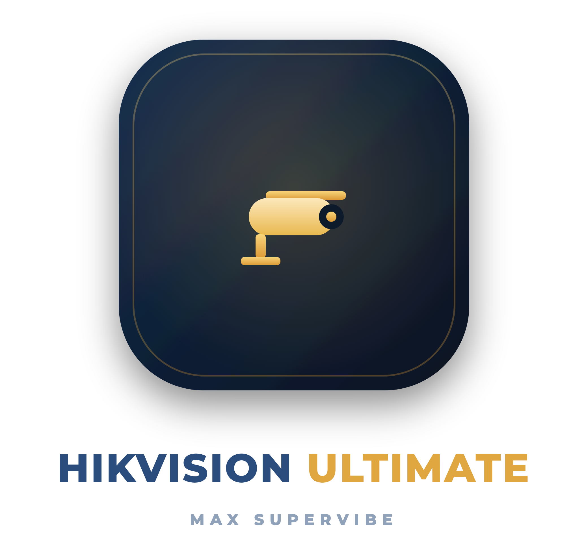
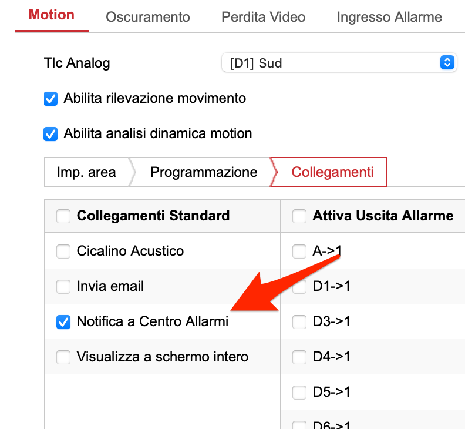

  

## Nodes for Hikvision (and compatible) Camera, Alarm, Radar, NVR, Doorbell, Speaker etc.

This is a set of nodes to handle ISAPI Hikvision messages. It works exclusively with **_HIKVISION_** and Hikvision based compatible devices. 
Works with cameras, NVR, Security Systems, Doorbells and also with specialized devices, like Radar (for example DS-PR1-60, DS-PR1-100 and DS-PR1-120). 
Digest authentication: it should work with all devices. 
All nodes are capable of auto reconnect if the connection is lost and are able to actively monitor the connection. 
Be sure to have installed **Node.js v20.18.1** or newer (issue a node -v command in a console, to check it out). 

 
 
 

[![NPM version][npm-version-image]][npm-url]
[![NPM downloads per month][npm-downloads-month-image]][npm-url]
[![NPM downloads total][npm-downloads-total-image]][npm-url]
[![MIT License][license-image]][license-url]

  

## WARNING

Due to the many models and firmware versions out there, not all **cams/NVR/Door Intercoms** does work. For example, many intercoms does not really support all APIs, that the official ISAPI documentation says it supports, thus, they don't work, not only with this node, but also with any software using the public ISAPI documentation. Please don't blame the developer, as it can do nothing to workaround such problems.  

## ENABLE NOFITICATIONS

For NVR/DVR, pleas remember to select "Notify Alarm Center" in the event window, otherwise the NVR won't emit any alarm event. 

 
 

## 📘 Documentation

The full documentation is on **[maxsupervibe.com](https://www.maxsupervibe.com/docs/hikvision-ultimate/)**, together with the help of every other Max Supervibe node.

  <a href="https://www.maxsupervibe.com/docs/hikvision-ultimate/">📘 Go to the documentation</a>

Release notes: [CHANGELOG.md](CHANGELOG.md)

[license-image]: https://img.shields.io/badge/license-MIT-blue.svg
[license-url]: https://github.com/Supergiovane/node-red-contrib-hikvision-ultimate/master/LICENSE
[npm-url]: https://npmjs.org/package/node-red-contrib-hikvision-ultimate
[npm-version-image]: https://img.shields.io/npm/v/node-red-contrib-hikvision-ultimate.svg
[npm-downloads-month-image]: https://img.shields.io/npm/dm/node-red-contrib-hikvision-ultimate.svg
[npm-downloads-total-image]: https://img.shields.io/npm/dt/node-red-contrib-hikvision-ultimate.svg
